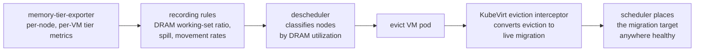

# Descheduler design: tier-aware rebalancing

The reaction half of the observability-driven operating model. This document
explains why the descheduler — not the scheduler — carries tier awareness,
how the extension works, and what a validated deployment looks like. The
configuration in [examples/descheduler-deployment.yaml](../examples/descheduler-deployment.yaml)
was deployed and exercised end-to-end on a lab cluster: a node pushed past
its DRAM working-set threshold had its VM live-migrated away automatically.

## Why the descheduler and not the scheduler

The Kubernetes scheduler places pods by static requests and capacities;
resource accounting moves only when pods start and stop. Memory utilization,
meanwhile, moves constantly: a VM's working set grows and shrinks
independently of its configured memory. Any overcommit regime therefore
needs a reaction loop separate from placement:



This is also the published industry pattern for utilization-driven
rebalancing of virtualization workloads: the descheduler consumes real
utilization (originally metrics-server usage, then pressure metrics from
Prometheus), evicts workloads from overutilized nodes, and steers new
placements away from pressured nodes. The scheduler never gains a dependency
on the observability stack.

## The extension: one query

Since v0.37, the upstream descheduler's `LowNodeUtilization` plugin can
classify nodes by **a Prometheus query**: the query returns a vector with an
`instance` label matching the node name and a value in (0, 1), compared
against the profile's thresholds. That single hook makes tier awareness a
matter of configuration — no plugin code:

```yaml
- name: LowNodeUtilization
  args:
    thresholds:
      MetricResource: 40        # nodes below are evacuation targets
    targetThresholds:
      MetricResource: 70        # nodes above are pressure sources
    metricsUtilization:
      source: Prometheus
      prometheus:
        query: label_replace(node:memory_dram_anon:ratio, "instance", "$1", "node", "(.*)")
```

The query is the DRAM **working-set** ratio (anonymous memory, THP included)
from the [observability design](observability-design.md) — not merged memory
utilization, which would read a node with idle CXL capacity as relaxed while
its DRAM is saturated. With this input:

- *overutilized* means "this node's fast tier is filling with working-set
  memory" — the state the hot-set-in-DRAM sizing rule warns about;
- the descheduler evicts VM launcher pods from such nodes;
- VMs opt into service-preserving reaction via `evictionStrategy:
  LiveMigrate`, which makes KubeVirt's eviction-interceptor webhook convert
  the eviction into a live migration instead of a shutdown.

The `DefaultEvictor` is configured with a label selector restricting
eviction candidates to launcher pods (`kubevirt.io=virt-launcher`) and with
local-storage eviction allowed (launcher pods always carry emptyDir runtime
volumes). Non-migratable VMs — those without an eviction strategy — are
never touched, because their launcher pods are not opted in and the
eviction is denied.

## Validated behavior

Recorded on a three-node lab cluster (CXL node emulated):

1. VM running on the CXL node; DRAM working-set ratio ~45%.
2. A bounded cold-memory workload pushes the node's DRAM working set past
   70% (measured 85–86% including THP).
3. Within one descheduling interval the profile logs: node classified
   `overutilized` at 85, underutilized targets exist, `Evicting pods from
   node worker-cxl-0`.
4. KubeVirt's `virt-launcher-eviction-interceptor` webhook denies the raw
   pod eviction — and that denial *is* the mechanism: it triggers evacuation
   of the VMI via **PreCopy live migration**.
5. The VM is `Running` on the DRAM-healthy node throughout; no shutdown, no
   guest-visible disruption.

One classification subtlety from validation: the initial run showed the
node at only 45% while 2.4 GiB of workload memory sat uncounted — anonymous
THP is reported in `AnonHugePages`, not `AnonPages`, and guests allocate as
THP. The working-set metric was corrected to include THP; see the
[observability design](observability-design.md) for the metric definitions
that make this signal honest.

## Deployment notes (OpenShift)

The manifests deploy upstream `descheduler:v0.37.0` as a single-replica
Deployment with a one-minute interval. Two platform integration points
needed care:

1. **Prometheus access**: the plugin queries the platform's Thanos Querier.
   The descheduler's Prometheus client authenticates with its service
   account (bound to `cluster-monitoring-view`) and verifies TLS against
   the CA bundle at the standard service-account path. Because Thanos
   presents a service-serving certificate rather than an API-server one,
   the deployment mounts a Secret at that path containing the token plus
   both CA chains. This is a workaround for an upstream limitation (no
   configurable Prometheus CA path); an upstream patch adding that knob
   would remove it.
2. **A TLS fix**: upstream's Prometheus client sets the TLS `ServerName`
   from the URL's `host:port`, which no certificate matches for any URL
   with an explicit port. The deployed image carries a one-line patch
   (`u.Hostname()` instead of `u.Host`), included as
   [examples/descheduler-servername-fix.patch](../examples/descheduler-servername-fix.patch) —
   a small upstream contribution candidate.

## Deliberate non-features

- **No scheduler changes.** Placement stays request-based. The DRAM
  fraction remains a planning constraint enforced by sizing and reaction,
  not an admission resource.
- **No per-workload tier API.** The profile's thresholds are cluster
  administrator policy. Workload owners opt into migration (or not) via the
  existing VM eviction strategy; they never express tier intent.
- **No tainting (yet).** A refinement worth adding — taint pressured nodes
  `PreferNoSchedule` so the scheduler does not refill a node the
  descheduler just drained, as published load-aware rebalancing profiles
  do — is straightforward follow-up work on the same mechanisms.
- **Eviction candidate choice** is currently the plugin's default (priority
  and QoS ordering). With per-VM spill metrics available, preferring the
  most-spilled VM as the eviction candidate is the natural next refinement.
