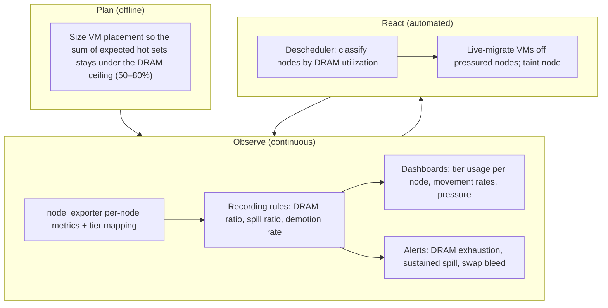

# MVP design: CXL memory extension with observability-driven operations

This document specifies the minimum viable feature. It has exactly four
components, in dependency order:

1. **CXL memory extends host RAM** — enable kernel memory tiering; no new
   placement API.
2. **Metrics** — make tier usage and tier movement visible to the
   observability stack.
3. **Recording rules** — derive the signals operators and automation consume.
4. **Descheduler extension** — react to tier pressure by rebalancing VMs.

Everything else is deliberately out of scope; see
[scope and alternatives](scope-and-alternatives.md). The principles behind
these choices are in [problem and principles](problem-and-principles.md).

## Component 1: CXL memory extends host RAM

### What happens

A CXL memory expander is configured (by platform firmware) as system RAM.
Linux onboards it as ordinary memory on a CPU-less NUMA node and assigns it a
memory tier by abstract distance. To the node, the cluster, and the scheduler,
the host now simply has more memory: Kubernetes reports the summed capacity
as the usual `memory` resource, minus reservations.

The kernel's tiering is then enabled where the distribution default is off:

```text
# Distribution default is typically 0 (off); tiering requires:
sysctl -w kernel.numa_demotion_enabled=1
```

Once enabled, the behavior described in
[research notes](research-notes.md#1-linux-memory-tiering) applies: under
memory pressure, reclaim demotes cold pages from DRAM to the CXL node (and,
when relevant, onward to swap), and promotes hot pages back to DRAM.

### What the operator must verify on each node

1. The CXL node exists and is online: `lsmem --summary`, or
   `/sys/devices/system/node/nodeN/` present with expected `MemTotal`.
2. Tier assignment is sensible: the CXL node's NUMA node ID appears in a
   *higher* (numerically larger, slower) tier's `nodelist` under
   `/sys/devices/virtual/memory_tiering/`.
3. Demotion is enabled (`kernel.numa_demotion_enabled=1`) and persisted
   through reboots by the node's configuration management.
4. The sizing rule below has been applied to the node's VM placement.

### What deliberately does not change

- **No scheduler change.** The scheduler keeps placing VMs by the summed
  memory capacity. The DRAM fraction is a planning constraint (below), not an
  admission-control resource.
- **No virtualization API change.** No new VM fields, classes, or annotations.
  A VM that does nothing special gets the tiered default: its cold guest
  pages may reside on CXL; its hot pages are kept in DRAM by kernel aging.
- **No page-mover daemon.** Demotion and promotion are kernel reclaim
  behavior.

### The sizing rule

CXL extends capacity; it does not make the hot set fit. The planning rule
from [principle P2](problem-and-principles.md#p2--hot-working-sets-must-fit-in-dram):

> The combined hot working set of a node's VMs should fit within DRAM with
> headroom — as a planning ceiling, on the order of **50–80% of DRAM**.

In practice:

- **Estimate** each VM's expected working set (historic measurements, or a
  fraction of its configured memory for known workload classes).
- **Place** VMs on a node such that the sum of estimates stays under the
  chosen DRAM ceiling.
- **Verify with metrics** (components 2–3): actual DRAM utilization, demotion
  rate, and pressure on the running node tell you whether the estimate was
  right.
- **React** (component 4) when a node persistently exceeds its ceiling.

The ceiling is a dial, not a constant: latency-sensitive estates run lower
(more headroom for spikes), batch estates run higher. The platform's
contribution is honest numbers to tune it against. Note the ceiling applies
to *hot* memory — cold pages beyond it are exactly what CXL capacity is for,
which is why overcommit beyond DRAM becomes safe-ish rather than reckless.

### Relationship to swap

Swap remains the tier below CXL (or below DRAM when no CXL exists). The two
are complementary: with CXL present, demotion prefers memory-to-memory
movement, and swap pressure decreases for the same overcommit ratio. Nothing
in this MVP changes how swap is configured; the observability design measures
both, because operators need the whole gradient to reason about a node.

## Component 2: Metrics

Three layers. Layers A and B are implemented in the
[memory-tier-exporter](https://github.com/shanemcd/memory-tier-exporter) and
deployed on the validation cluster; layer C is implemented there too and
deserves upstream hardening before production use. A discovery from
implementation is folded in: on fleet-managed nodes (OpenShift), even the
"existing exporters" part of layer A is unavailable — the managed
node-exporter disables the per-NUMA collector, allow-lists vmstat to exclude
demotion counters, and has no PSI — so the exporter implements all three
layers itself.

### Layer A — node tier usage (existing exporters, enable and verify)

| Signal | Metric | Source | Status |
|---|---|---|---|
The exporter's exact metric names, sources, and caveats are specified in the
[observability design](observability-design.md). The one-line summary:
per-node tier capacity and usage (including the anonymous-memory split that
matters for working sets), demotion and promotion counters, PSI where the
kernel provides it, and per-VM tier attribution from launcher-pod cgroups.

### Layer B — tier mapping (one small new export)

The per-NUMA-node metrics say *how much* memory each node carries but not
*which tier* each node is. That mapping lives in
`/sys/devices/virtual/memory_tiering/memory_tierN/nodelist` and was not
exported by anything. The exporter publishes it as a `tier` label (the
kernel's memory-tier number) plus a per-node `rank` (0 = fastest tier
present, i.e. DRAM on current platforms), attached to every series:

```text
node_memory_tier_nodes{node="worker-cxl-0",numa_node="0",tier="4",rank="0"} 1
node_memory_tier_nodes{node="worker-cxl-0",numa_node="1",tier="22",rank="1"} 1
```

With tier labels on the raw metrics, standard PromQL aggregation turns them
into per-*tier* metrics (the recording rules in component 3 do exactly
this). On kernels without the tier sysfs tree, every NUMA node reports as a
single synthesized tier, so DRAM-only clusters still get per-node
visibility.

### Layer C — per-VM tier attribution (follow-up, not in the first cut)

Operators ask "which VM is bleeding into CXL?" The kernel exposes
per-cgroup, per-NUMA-node memory (`memory.numa_stat` in cgroup v2), and each
VM runs inside a launcher pod whose cgroup the exporter reads via the
Kubernetes API. The result is per-workload, per-tier attribution:

```text
node_memory_tier_workload_anon_bytes{namespace="default",workload="tier-demo",workload_kind="VirtualMachineInstance",numa_node="1",tier="22",rank="1"} 1.5747072e+08
```

Validated end-to-end: a bounded reclaim of the VM's cgroup demoted exactly
150 MiB of its cold guest memory to CXL while the VM kept running, and the
per-workload spill ratio and demotion rate were visible in Prometheus seconds
later. These numbers include launcher overhead — attribution for rebalancing
decisions, not billing-grade accounting; see the
[observability design](observability-design.md).

## Component 3: Recording rules

Recording rules turn the raw exporter metrics into the small set of series
that operators, dashboards, alerts, and the descheduler consume. The MVP
defines (full PromQL in [examples/recording-rules.yaml](../examples/recording-rules.yaml);
deployed and validated on the lab cluster's platform Prometheus):

| Rule (illustrative name) | Meaning |
|---|---|
| `node:memory_tier_used_bytes:sum` | Used bytes per node per tier (join per-node metrics with tier mapping) |
| `node:memory_tier_used:ratio` | Tier utilization fraction, per node and tier |
| `node:memory_dram_used:ratio` | The headline number: DRAM utilization per node |
| `node:memory_dram_anon:ratio` | Working-set DRAM utilization (anonymous memory, THP included) — the sizing-rule signal |
| `node:memory_pgdemote:rate5m` | Demotion throughput per node (pages/s) |
| `node:memory_pgpromote:rate5m` | Promotion throughput per node |
| `node:memory_spilled:ratio` | Fraction of a node's used memory residing below DRAM |
| `workload:memory_spilled:ratio` | Per-workload fraction of resident memory below DRAM |

Naming follows the established `<scope>:<name>:<operation>` convention already
used by the platform's virtualization recording rules (for example
`container:kubevirt_memory_delta_from_requested_bytes:max`), so tier rules
read as a natural extension of the existing rule set.

These rules exist so that every consumer — human dashboards, alert definitions,
and the descheduler extension — reasons over a handful of stable, pre-joined
series instead of re-deriving them from raw exporter output.

## Component 4: Descheduler extension

The reaction loop. The descheduler already has a documented, merged mechanism
for classifying nodes by *actual* utilization (metrics-server based) and a
published pattern for classifying nodes by *pressure* (PSI from Prometheus),
evicting VMs to trigger live migration, and tainting overutilized nodes so
the scheduler steers new placements away. The MVP extends that established
loop with tier awareness:

1. **Classify by DRAM utilization**, not merged memory: a node whose DRAM is
   exhausted while its CXL capacity is idle is *overutilized for its fast
   tier* even if its summed memory utilization looks moderate. The
   `node:memory_dram_used:ratio` recording rule provides the signal.
2. **Evict VMs from over-threshold nodes** — for VM workloads, descheduler
   eviction triggers live migration, preserving service.
3. **Taint pressured nodes** (`PreferNoSchedule`) so the scheduler does not
   immediately refill them; untaint when the node recovers below threshold.
4. Optionally weight eviction candidates by per-VM tier attribution once
   Layer C exists (evict the VMs that actually spilled, not an arbitrary
   one).

The full design, the documented precedents it builds on, the deployed
configuration, and recorded evidence of an automated live migration away
from a pressured node are in the
[descheduler design](descheduler-design.md).

## The operating model, end to end

For a cluster administrator, day-2 operation with this MVP looks like:



- **Planning** uses the sizing rule; nothing enforces it (principle P3).
- **Observation** is the source of truth for whether the plan was right.
- **Reaction** is automated through the descheduler, within thresholds the
  administrator sets; humans handle the alerted exceptions.

## Success criteria

The MVP is successful when, on a CXL-capable node:

1. **Demonstrated.** A VM spilled 150 MiB of cold guest memory to CXL under
   a bounded reclaim while staying Running; a 2 GiB global reclaim moved
   ~1.2 GiB of cold pages off DRAM; the node's DRAM working-set ratio,
   spill ratio, and demotion rate told the whole story in Prometheus.
   *(Emulated CXL demonstrates the software path; physical devices remain
   the arbiter of performance.)*
2. **Demonstrated.** Tier fullness, movement rates, and per-VM attribution
   were all queryable from the platform's Prometheus during validation.
   (Pressure stall information is absent on the validation kernel — a
   lab-kernel limitation, visible as missing series rather than zeros.)
3. **Demonstrated.** A node pushed to 85% DRAM working set was classified
   overutilized by the tier-aware descheduler profile; its VM was evicted
   and live-migrated (PreCopy) to a DRAM-healthy node, Running throughout.
4. **Held.** The scheduler's resource model is untouched; no workload object
   carries tier configuration — the one workload-side opt-in is the existing
   VM `evictionStrategy`, which is about migration, not tiers.

What would *falsify* the approach — hot sets that do not stay in DRAM under
kernel aging alone, demotion so aggressive it starves hot pages, or reaction
loops that oscillate — is exactly what the metrics exist to reveal, early.
