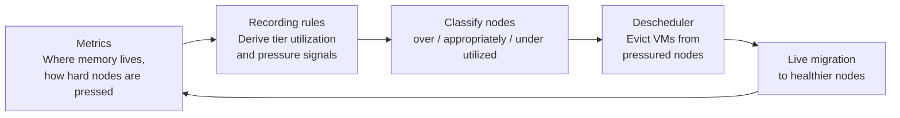

# The problem, and the principles behind the design

This document explains, from first principles, why extending host memory with
CXL devices is worth doing, why the operating model must be
observability-driven, and why the first deliverable deliberately avoids new
placement APIs and enforcement mechanisms. It is written for readers familiar
with Kubernetes and virtualization in general, but it does not assume prior
exposure to memory tiering.

## 1. The problem: memory caps VM density

When operators pack virtual machines onto servers, memory is usually the first
binding constraint. Compute scales well: CPU overcommit is routine and
well-understood. Memory is different:

- A VM's guest memory must be backed by host memory. Sharing it between VMs is
  only possible to the extent the guests actually touch their memory and the
  platform can reclaim the rest.
- DRAM is expensive. On memory-heavy servers it can dominate the bill of
  materials.
- Operators therefore *overcommit memory*: they place VMs whose combined
  configured memory exceeds what is physically resident, counting on the fact
  that not all VMs touch all their memory at once.

Overcommit is a bet. The bet pays off when the *hot working sets* — the memory
each running workload actually uses — together fit in physical DRAM. The bet
fails when they do not, and the system must then shed load somewhere slower:
swap, or — with CXL — expanded memory.

Today's platforms already make this bet in specific ways: hypervisor memory
ballooning and free-page reporting reclaim unused guest pages; swap moves cold
anonymous pages to disk; administrator knobs let the scheduler see a shrunken
memory request so more VMs fit per node. What none of these change is the
amount of fast memory available.

## 2. The opportunity: CXL adds capacity, and the kernel already tiers it

Compute Express Link (CXL) lets a host attach additional memory over a PCIe
fabric. A CXL memory expander configured as system RAM ("CXL.mem" in the
type-3 device model) is onboarded by Linux as ordinary memory on a NUMA node —
typically a node without CPUs.

Two properties make this attractive for VM density:

1. **It is real memory, not storage.** Pages on CXL memory are resident and
   randomly accessible, at added latencies commonly an order of magnitude
   below disk. It extends capacity without adding CPU-attached DRAM.
2. **The kernel already manages it as a tier.** Linux assigns each NUMA node
   to a *memory tier* by abstract distance (faster tiers first). Under memory
   pressure, reclaim can *demote* cold pages from DRAM to the slower tier
   instead of swapping or discarding them, and *promote* hot pages back. The
   placement engine — deciding what is hot and cold — is the kernel's own
   aging machinery (LRU/MGLRU), not a userspace daemon.

In other words: the mechanism needed for "CXL extends RAM" already exists in
the operating system. The work is to make its behavior *visible* and to
*react* to it operationally.

### The performance gradient

For planning, the tiers form a gradient of increasing access cost:

| Tier | Typical added latency (order of magnitude) | What it is |
|---|---|---|
| Local DRAM | baseline (tens of ns) | CPU-attached memory |
| CXL memory | ~100–200 ns added | Fabric-attached expander memory |
| Swap | milliseconds | Disk-backed pages |

Two consequences follow:

- **Cold memory can live anywhere; hot memory belongs in DRAM.** A workload
  whose frequently accessed pages spill to CXL or swap slows down. A workload
  whose cold pages spill loses little.
- **CXL and swap are complementary, and partly interchangeable.** Both are
  lower tiers below DRAM. Demotion prefers CXL when it exists (memory to
  memory), falling back to swap (memory to disk). An operator using CXL for
  capacity gets less swap pressure for the same overcommit ratio; an operator
  without CXL gets the same *operational* model with swap as the only lower
  tier. The monitoring and reaction design in this repository treats them as
  one gradient, which is exactly how the kernel treats them.

CXL device performance varies by implementation — an expander card populated
with conventional DRAM modules behaves differently from other devices — which
is why firmware-reported characteristics (HMAT/CDAT) and measured application
impact, not the CXL label alone, must inform workload decisions. This
repository claims no physical-device performance numbers.

## 3. Principles

### P1 — The kernel is the tiering engine

Pages move between tiers under reclaim pressure, placed by kernel aging. A
userspace page mover is an alternative architecture; the industry has tried
it, and deployments have repeatedly converged back on kernel-native tiering
for this use case. Building another mover would duplicate what Linux already
does, poorly. The MVP therefore adds **no page-placement daemon** and **no
per-page policy engine**. It enables kernel tiering where the distribution
default is off, and it makes the kernel's decisions observable.

### P2 — Hot working sets must fit in DRAM

CXL extends capacity; it does not repeal physics. If a node's aggregate hot
working set exceeds DRAM, hot pages will live on CXL and performance will
degrade no matter what the software does. The planning rule that makes
overcommit safe with CXL is the same rule that makes it safe with swap:

> **The combined hot working set of a node's VMs should fit within DRAM with
> headroom — as a planning ceiling, on the order of 50–80% of DRAM.**

This is a *sizing guideline* for operators, not an admission-control
mechanism. It accounts for spikes, migrations in flight, and kernel overhead.
Choosing the exact percentage is a per-workload, per-business decision: a
latency-sensitive estate plans to the low end; a batch estate can push the
high end. The platform's job is to make the actual number visible (see
[observability design](observability-design.md)) so operators can tune it
against evidence rather than hope.

### P3 — Observe and react; do not promise and enforce

The tempting design is to let each workload *request* a tier ("this VM's
memory must stay in DRAM") and have the platform *enforce* it. That design
has a fatal dependency: the operating system cannot currently guarantee it.
Linux cpuset masks restrict *allocation*, but reclaim-driven demotion can
still move pages between tiers — the kernel's own documentation describes
demotion ignoring or only partially respecting those masks, and shared pages
charged to another cgroup can move regardless. Hard per-workload residency
would require memory locking or dedicated hugepage pools: heavyweight,
capacity-fragmenting mechanisms with real operational cost.

So the MVP inverts the model:

- **The default is tiered.** A VM's cold pages may live on CXL; the kernel
  decides. No per-VM configuration is required for this.
- **The guarantee is operational, not per-page.** Instead of promising each
  VM where its bytes live, the platform watches where memory actually lives
  and how hard the node is pressed, and *moves workloads* when the numbers
  say the node is unhealthy.
- **Workload opt-out is deferred, not denied.** A future mechanism may offer
  latency-sensitive workloads a DRAM-only placement class (the natural
  expression is an opt-out in the style of swap usage controls), built on
  mechanisms that can actually deliver it. The [scope document](scope-and-alternatives.md)
  records why it is not in the first deliverable.

### P4 — Overcommit operations are driven by observability

The Kubernetes scheduler is deliberately static: it places pods by requests
and capacities, not by live utilization, and resource accounting only moves
when pods start and stop. Utilization, meanwhile, moves constantly. Any
overcommit regime therefore needs a *reaction loop* separate from scheduling:

This loop already exists as a published pattern — the descheduler consuming
real utilization and pressure metrics from the observability stack, evicting
VMs (which triggers live migration), and tainting pressured nodes so the
scheduler steers new placements away — see the [descheduler design](descheduler-design.md)
for the documented precedents. What the loop lacks today is *tier awareness*:
its "memory" is one merged number, so DRAM pressure is invisible on a node
whose CXL capacity is mostly idle. Extending that loop, not adding scheduler
APIs, is the MVP's operational work.

### P5 — Policy belongs to the infrastructure, not to each workload

Memory overcommitment is an infrastructure-level decision: the operator
decides how hard to pack nodes, and the platform provides the guardrails.
Individual workload owners should at most express *needs* ("latency
sensitive"), not *mechanisms* ("pin to DRAM node 0 via cpuset"). Three
reasons:

- Workload owners rarely know their own hot/cold profile well enough to
  place pages themselves; the kernel measures it continuously.
- A fleet-wide policy change must not require editing ten thousand workload
  objects. Infrastructure-owned policy changes by re-balancing, not by
  per-workload surgery.
- Mechanisms change (cpuset today, locking tomorrow); needs are stable.

The MVP takes this to its logical minimum: **no new workload-facing API at
all**. The default tiered behavior requires nothing from workload owners;
all new surface is in metrics, rules, and the descheduler — cluster-operator
territory.

## 4. What "useful density" means

The goal is not "more VMs booted" or "a bigger memory number reported to the
scheduler." Those are trivially achievable and worthless. The goal is **more
VMs running usefully at acceptable service levels on the same hardware**:

- Capacity from CXL is actually used (cold pages spill; DRAM is not
  artificially idle).
- Service levels are defined by the operator (for example: hot set fits in
  DRAM; memory pressure stall time below a threshold) and *measured*, not
  assumed.
- When a node violates its service level, the platform reacts by moving
  workloads, and the operator can see the whole story in metrics.

That definition forces honesty: any density claim needs a workload, a
service-level criterion, and a DRAM-only baseline to compare against. On
emulated CXL, this repository can validate software behavior only — physical
devices remain the arbiter of performance.

## 5. Where this leads

With the problem and principles fixed, the [MVP design](mvp-design.md)
specifies the four things that get built: enable kernel tiering, publish
tier-aware metrics, derive recording rules, and extend the descheduler's
reaction loop. Everything else — and there is a lot of "else" considered and
deliberately deferred — is catalogued in
[scope and alternatives](scope-and-alternatives.md).
